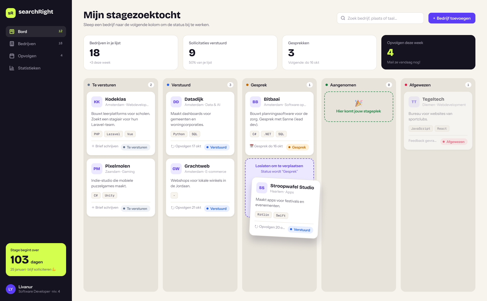
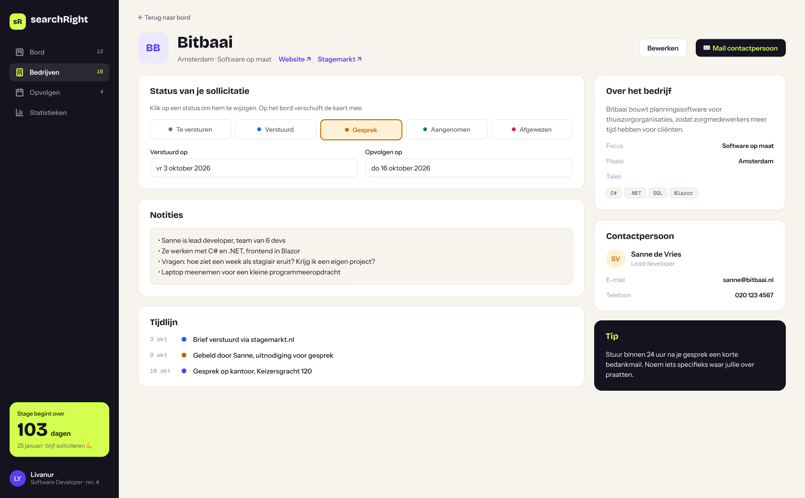
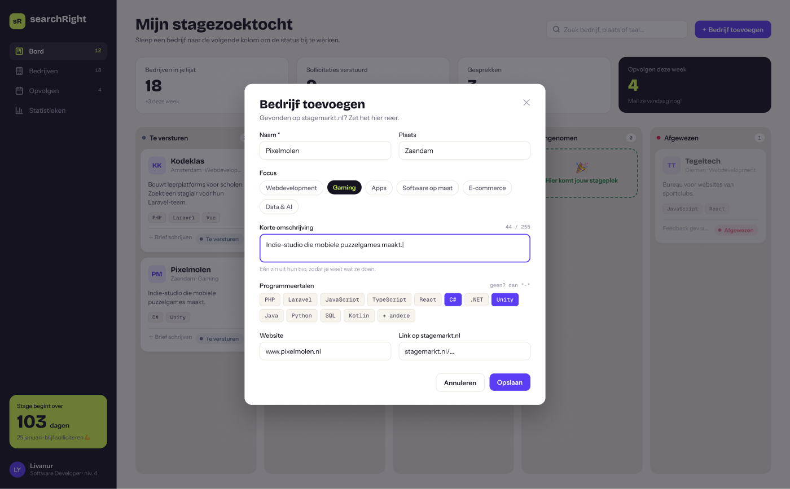
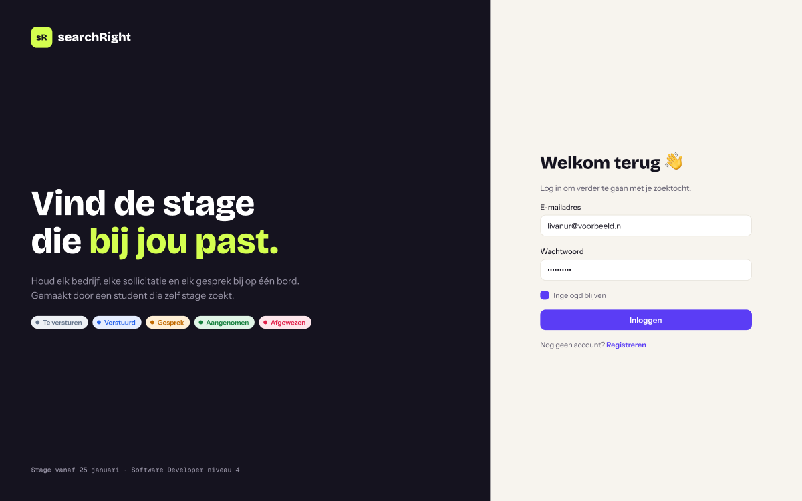

# searchRight

**Houd je stagezoektocht overzichtelijk.** searchRight is een web app waarmee je op een Kanban-bord bijhoudt welke bedrijven je hebt benaderd (bijvoorbeeld via [stagemarkt.nl](https://stagemarkt.nl)), wat de status van elke sollicitatie is en wanneer je moet opvolgen.

Ik bouw dit project tijdens mijn opleiding Software Developer (niveau 4), terwijl ik zelf een stage zoek. Ik gebruik de app dus zelf.

### 👉 Probeer de demo: [searchright.onrender.com](https://searchright.onrender.com)

Log in met **demo@searchright.app** / **demo1234**.
*De demo draait op een gratis server en kan bij het eerste bezoek ongeveer een minuut nodig hebben om op te starten.*



## Functies

- **Kanban-bord** met vijf kolommen: *Te versturen → Verstuurd → Gesprek → Aangenomen / Afgewezen*
- **Slepen om de status te wijzigen**: de status wordt direct opgeslagen, zonder de pagina te herladen
- **Statistieken** die meteen meeveranderen: verstuurde sollicitaties, gesprekken en wat je deze week moet opvolgen
- **Aftelteller** tot de start van mijn stage
- **Bedrijven toevoegen** met focus (bijv. Gaming of Webdevelopment), een korte bio en de programmeertalen die ze gebruiken (geen talen bekend? dan zie je "-")
- **Detailpagina** per bedrijf: status met één klik wijzigen, verstuur- en opvolgdatum, notities, tijdlijn en een tip die bij de status past
- **Zoeken en filteren** op naam, plaats, focus of programmeertaal
- **Eigen account**: inloggen en registreren; je ziet alleen je eigen bedrijven

## Ontwerp

Ik heb de app eerst ontworpen in **Figma**, met een eigen kleurenpalet (als variabelen), lettertypes en herbruikbare componenten zoals de statuslabels, taal-chips en bedrijfskaarten. Daarna heb ik het ontwerp nagebouwd met Blade en Tailwind CSS.

| Bedrijfsdetail | Bedrijf toevoegen | Inloggen |
|---|---|---|
|  |  |  |

## Techniek

| Onderdeel  | Gebruikt |
|------------|----------|
| Backend    | PHP 8.3, Laravel 13 |
| Frontend   | Blade-componenten, Tailwind CSS 4, Vite, JavaScript (drag & drop) |
| Database   | MySQL (lokaal), PostgreSQL (online) |
| Ontwerp    | Figma |
| Omgeving   | Docker (Nginx, PHP-FPM, MySQL, Node) |
| Hosting    | Render (Docker + PostgreSQL) |
| Tests      | PHPUnit feature tests |

Wat ik onder andere heb geleerd en toegepast:

- **Database-relaties**: one-to-many (gebruiker → bedrijven → sollicitaties) en many-to-many (bedrijven ↔ programmeertalen)
- **PHP-enum** voor de status van een sollicitatie, met Nederlandse labels en kleuren
- **Beveiliging**: policies zodat je alleen je eigen bedrijven ziet, CSRF-bescherming en een limiet op inlogpogingen
- **Validatie** met Form Requests en Nederlandse foutmeldingen
- **Fetch API** om de status op te slaan na het slepen, en de kaart terug te zetten als het misgaat
- **Docker** voor lokaal ontwikkelen én een aparte productie-image voor Render

## Lokaal draaien

Je hebt alleen [Docker Desktop](https://www.docker.com/products/docker-desktop/) nodig.

```bash
git clone https://github.com/LivaYanal/searchRight.git
cd searchRight
docker compose up -d
```

De eerste keer duurt dit een paar minuten. Open daarna **http://localhost:8088**.

Testdata toevoegen (inclusief het demo-account):

```bash
docker compose exec app php artisan db:seed
docker compose exec app php artisan db:seed --class=DemoSeeder
```

Handige commando's:

```bash
docker compose exec app php artisan test   # tests draaien
docker compose logs -f app                 # logs bekijken
docker compose down                        # alles stoppen
```

## Gemaakt met hulp van AI

Ik heb dit project gebouwd samen met **Claude**, een AI-assistent. Het idee, de functies en de ontwerpkeuzes kwamen van mij; Claude hielp met het uitwerken van de code en het Figma-ontwerp. We werkten stap voor stap, zodat ik bij elke stap begreep wat er gebeurde en waarom.

## Over mij

**Livanur Yanalioglu**, student Software Developer (niveau 4) aan het ROC van Amsterdam.
🔎 **Op zoek naar een stage vanaf 25 januari 2027** in de regio Amsterdam.

[LinkedIn](https://www.linkedin.com/in/livanur-yanalioglu-28001832a/)
